# Enterprise Mobile Automation Framework (Appium 2.x + WebdriverIO 9 + TypeScript)

[](https://www.typescriptlang.org/)
[](https://webdriver.io/)
[](https://appium.io/)
[]()
[]()
[](https://qameta.io/allure-report/)
[](https://github.com/features/actions)
[](https://prettier.io/)
[](https://opensource.org/licenses/MIT)

> A modern, production-ready, cross-platform mobile test automation framework engineered for enterprise scalability. Showcases advanced mobile interactions across both **Android** (`UiAutomator2`) and **iOS** (`XCUITest`) using clean **Page Object Model (POM)** architecture, **W3C Actions API** gestures, resilient synchronization, and **Allure** test observability.

---

## 🌟 Key Architectural Highlights

- **Appium 2.x & WebdriverIO 9 Standards**: Decoupled driver architecture utilizing native W3C pointer actions instead of deprecated TouchAction APIs.
- **Dual-Platform Architecture (Android + iOS)**:
  - **Android (`UiAutomator2`)**: Accessibility ID, Resource ID, UIAutomator selectors (`new UiSelector()`), native activity manager (`startActivity`), calendar pickers, and alerts.
  - **iOS (`XCUITest`)**: iOS Class Chains (`-ios class chain:`), Predicate Strings (`-ios predicate string:`), native `UIPickerView` wheels, `UISlider` controls, and swipe-to-delete cell interactions.
  - **Unified Cross-Platform Abstraction**: Dynamic `ScreenFactory` and `BaseScreen` locator resolution that can execute identical business scenarios across both operating systems.
- **Complex W3C Gestures Engine**:
  - Vertical scroll into view with element detection
  - Multi-direction touch swiping (Up, Down, Left, Right)
  - Horizontal carousel scrolling
  - Drag and Drop with coordinate & element binding
  - Long-press / Touch-and-Hold
  - Multi-touch pinch-to-zoom
- **Device & OS Capabilities Control**:
  - Application lifecycle management (backgrounding, resuming, termination, activation)
  - Device orientation toggles (Portrait <-> Landscape)
  - Deep linking navigation
  - Native alert and permission dialog interception
  - Biometric mock simulation (Fingerprint / FaceID)
  - System clipboard management
- **Enterprise Reporting & Observability**:
  - Full **Allure 2** integration with step-by-step reporting (`addStep`, `addEpic`, `addFeature`, `addStory`, `addSeverity`)
  - Automatic screenshot capture on test failure hooked directly into test teardown
  - Concise terminal output via `@wdio/spec-reporter`
- **Modern Developer Experience & CI/CD**:
  - Strict TypeScript compilation with compile-time type validation
  - Config hierarchy (`wdio.shared.conf.ts`, `wdio.android.conf.ts`, `wdio.ios.conf.ts`)
  - Multi-environment runtime configuration via `.env`
  - GitHub Actions matrix workflow running automated tests in emulators/simulators and deploying Allure reports to GitHub Pages.

---

## 🏗️ Architecture & Design Pattern

```mermaid
flowchart TD
    subgraph Config Layer
        Shared[wdio.shared.conf.ts]
        AndroidConf[wdio.android.conf.ts]
        IOSConf[wdio.ios.conf.ts]
        Shared --> AndroidConf
        Shared --> IOSConf
    end

    subgraph Core Engine
        BaseScreen[BaseScreen]
        Gestures[Gestures - W3C Actions]
        Device[Device Controller]
        AlertHandler[Alert & Dialog Handler]
        Logger[Structured Logger]
        Reporter[Allure Reporter Wrapper]
    end

    subgraph Screen Object Layer
        subgraph Android Screens
            AP_Home[ApiDemos Home Screen]
            AP_Dialogs[Alert Dialogs Screen]
            AP_Views[Views & Gestures Screen]
            AP_Date[DatePicker Screen]
            CN_Home[ColorNote Home Screen]
            CN_Edit[Edit Note Screen]
            CN_Check[Checklist Screen]
        end

        subgraph iOS Screens
            UI_Home[UIKitCatalog Home Screen]
            UI_Alerts[Alert Views Screen]
            UI_Pickers[Pickers & Sliders Screen]
            TD_Home[Todo Home Screen]
            TD_Add[Add Task Screen]
        end

        Factory[ScreenFactory - Cross-Platform]
    end

    subgraph Test Suites
        AndroidSpecs[Android Specs]
        IOSSpecs[iOS Specs]
        CrossSpecs[Unified Cross-Platform Specs]
    end

    BaseScreen --> AP_Home & AP_Dialogs & AP_Views & AP_Date & CN_Home & CN_Edit & CN_Check
    BaseScreen --> UI_Home & UI_Alerts & UI_Pickers & TD_Home & TD_Add
    AP_Home & UI_Home --> Factory

    AndroidConf --> AndroidSpecs
    IOSConf --> IOSSpecs
    AndroidConf & IOSConf --> CrossSpecs
```



---

## 📁 Repository Structure

```
.
├── .github/
│   └── workflows/
│       └── mobile-e2e.yml            # GitHub Actions CI matrix (Android API 34 + iOS 17.4 + Allure Pages)
├── app/
│   ├── android/
│   │   ├── ApiDemos-debug.apk        # Android Native Controls & Gestures Demo APK
│   │   └── ColorNote+Notepad.apk     # Android E2E Business Application APK
│   └── ios/
│       └── README.md                 # iOS .app placement guide (UIKitCatalog / MVCTodo / SauceDemo)
├── src/
│   ├── constants/
│   │   ├── apps.ts                   # Packages, bundle IDs, activities, and deep links
│   │   ├── gestures.ts               # Swipe directions, speed presets, and thresholds
│   │   └── timeouts.ts               # Standardized polling, explicit, and animation timeouts
│   ├── core/
│   │   ├── BaseScreen.ts             # Abstract POM base with resilient waits and fluent interactions
│   │   ├── Gestures.ts               # Modern W3C Actions pointer implementation
│   │   ├── Device.ts                 # Hardware, biometrics, clipboard, orientation, app lifecycle
│   │   ├── AlertHandler.ts           # Native OS & In-App dialog handler
│   │   ├── Logger.ts                 # Colored console logger with Allure step forwarding
│   │   └── index.ts                  # Core barrel export
│   ├── screens/
│   │   ├── android/
│   │   │   ├── apidemos/             # ApiDemos Screen Objects (Home, App, Dialogs, Views, DatePicker)
│   │   │   └── colornote/            # ColorNote Screen Objects (Home, Edit Note, Checklist)
│   │   ├── ios/
│   │   │   ├── uikit/                # UIKitCatalog Screen Objects (Home, Alerts, Pickers, Sliders)
│   │   │   └── todo/                 # MVCTodo Screen Objects (Home, Add Task)
│   │   ├── cross-platform/
│   │   │   └── ScreenFactory.ts      # Unified cross-platform Screen Object factory
│   │   └── index.ts                  # Screens barrel export
│   ├── types/
│   │   └── index.ts                  # TypeScript models (Points, Swipes, NoteData, TodoItem)
│   └── utils/
│       ├── reporter.ts               # Allure metadata enricher (Epics, Features, Severities)
│       └── testData.ts               # Dynamic test data generators & fixtures
├── test/
│   └── specs/
│       ├── android/
│       │   ├── apidemos/
│       │   │   ├── alertDialogs.spec.ts   # 2-button, radio, multi-choice, and text entry dialogs
│       │   │   ├── gestures.spec.ts       # Vertical/horizontal scrolls, drag & drop, orientation
│       │   │   └── datePicker.spec.ts     # Calendar month transitions, day selections
│       │   └── colornote/
│       │       ├── createNote.spec.ts     # E2E Text note creation, verification, and deletion
│       │       └── checklist.spec.ts      # E2E Checklist creation, task toggles
│       ├── ios/
│       │   ├── uikit/
│       │   │   ├── alertsAndActionSheets.spec.ts  # Native iOS alerts, action sheets, secure text
│       │   │   ├── pickersAndSliders.spec.ts      # Multi-wheel UIPickerView & UISlider interactions
│       │   │   └── gestures.spec.ts               # TableView scroll and orientation
│       │   └── todo/
│       │       └── todoFlow.spec.ts               # E2E Todo creation and swipe-to-delete cell
│       ├── cross-platform/
│       │   └── crossPlatformDemo.spec.ts          # Dual-platform dynamic execution
│       ├── android-findElements.spec.ts           # Android selector strategies demonstration
│       └── android-native.spec.ts                 # Activity launches and UiScrollable examples
├── wdio.shared.conf.ts               # Base runner configuration (Allure, timeouts, reporters)
├── wdio.android.conf.ts              # Android UiAutomator2 emulator / real device capabilities
├── wdio.ios.conf.ts                  # iOS XCUITest simulator capabilities
├── wdio.conf.ts                      # Smart gateway configuration (delegates via PLATFORM env var)
├── .env.example                      # Environment variables template
├── .prettierrc                       # Code style rules
├── tsconfig.json                     # TypeScript compiler configuration
└── package.json                      # Scripts, dependencies, and metadata
```

---

## 🚀 Quick Start Guide

### Prerequisites

1. **Node.js**: `v18.x` or `v20.x` LTS ([Download](https://nodejs.org/))
2. **Java JDK**: JDK 17+ configured with `JAVA_HOME` ([Temurin JDK](https://adoptium.net/))
3. **Android Studio**: Android SDK installed with `ANDROID_HOME` configured, and an Android Emulator (API 30 - 34).
4. **Xcode** *(macOS only for iOS)*: Installed with Command Line Tools and iOS Simulator.
5. **Appium 2.x & Drivers**:
   ```bash
   npm install -g appium
   appium driver install uiautomator2
   appium driver install xcuitest # macOS only
   ```

### Installation

```bash
# Clone repository
git clone <repository-url>
cd appium

# Install dependencies
npm install

# Copy environment configuration
cp .env.example .env
```

---

## 💼 Mobile SDET Interview Scenarios & Complex Implementations

A dedicated suite covering the most frequently asked technical scenarios in Senior Mobile Automation & SDET interviews:

- **Hybrid Context Switching**: Switching between `NATIVE_APP` and `WEBVIEW_*` contexts with DOM JavaScript execution ([`ContextHandler.ts`](file:///d:/Testing/framework/full-stack-frameworks/appium/src/core/ContextHandler.ts)).
- **W3C Actions API vs TouchAction**: Why `TouchAction` was removed in Appium 2.x and how sequential pointer timelines work ([`Gestures.ts`](file:///d:/Testing/framework/full-stack-frameworks/appium/src/core/Gestures.ts)).
- **Canvas Signature Drawing**: Continuous multi-point vector path gestures (`drawPath`).
- **Push Notification Drawer & OTP Parsing**: Accessing OS notification drawer outside app sandbox and extracting OTP with regex ([`test/specs/interviews/notificationsAndOtp.spec.ts`](file:///d:/Testing/framework/full-stack-frameworks/appium/test/specs/interviews/notificationsAndOtp.spec.ts)).
- **Network Drops & Offline Sync**: Toggling airplane mode mid-transaction and verifying recovery.
- **Biometric Mocking & Deep Linking**: Bypassing logins via FaceID / Fingerprint and direct routing via URI schemes.
- **Mobile Performance Profiling**: Real-time CPU % and PSS Memory (MB) tracking via `driver.getPerformanceData` ([`PerformanceHelper.ts`](file:///d:/Testing/framework/full-stack-frameworks/appium/src/core/PerformanceHelper.ts)).

👉 **Read the complete guide:** [INTERVIEW_PREP.md](file:///d:/Testing/framework/full-stack-frameworks/appium/INTERVIEW_PREP.md)

---

## 🧪 Running Tests

### Android Test Suites

```bash
# Run all Android test specifications
npm run test:android

# Run ApiDemos Alert Dialogs, Gestures, and DatePicker tests
npm run test:android:apidemos

# Run ColorNote E2E Notepad & Checklist tests
npm run test:android:colornote

# Run Advanced W3C Actions Gestures tests
npm run test:android:gestures

# Run Top SDET Interview Scenarios (WebViews, Notifications, Performance, Signatures)
npm run test:interview
```

### iOS Test Suites

```bash
# Run all iOS test specifications
npm run test:ios

# Run UIKitCatalog Native Alerts, Pickers, and Sliders tests
npm run test:ios:uikit

# Run iOS Todo E2E Task Management tests
npm run test:ios:todo
```

### Cross-Platform Execution

```bash
# Run Unified dual-platform demo test
npm run test:crossplatform

# Or toggle platform dynamically via environment variable
PLATFORM=ios npx wdio run wdio.conf.ts
PLATFORM=android npx wdio run wdio.conf.ts
```

### Code Quality & Formatting

```bash
# Run compile-time TypeScript type check
npm run typecheck

# Format codebase with Prettier
npm run format
```

---

## 📊 Allure Test Reporting

The framework automatically attaches screenshots on test failure and enriches reports with Epics, Features, Stories, and execution steps.

```bash
# Generate HTML report from results
npm run report:generate

# Open interactive Allure report in browser
npm run report:open

# Combined command: generate and immediately open
npm run report
```

### Sample Report Features
- **Categorization**: Defects categorized by Product Bugs vs. Automation Flakiness.
- **Visual Evidence**: Base64 screenshots attached directly to the failed test step.
- **Hierarchy Breakdown**: Tests categorized under Epics (e.g., `Mobile Gestures & Device Automation`) -> Features (e.g., `W3C Actions API`) -> Stories (e.g., `Vertical Scroll Into View`).

---

## 📱 Complex Test Scenarios Covered

| Scenario ID | Platform | Component | Description |
|---|---|---|---|
| `TC-AD-001` | Android | Two-Button Dialog | Triggers native Android alert, validates message text, and dismisses safely |
| `TC-AD-002` | Android | Single-Choice Radio | Opens radio button dialog, selects option, and confirms |
| `TC-AD-003` | Android | Multi-Choice Checkbox | Toggles multiple asynchronous checkboxes and saves state |
| `TC-AD-004` | Android | Text Entry Modal | Enters username and password inside modal dialog form |
| `TC-GST-001` | Android | W3C Vertical Scroll | Scrolls through off-screen elements using pointer actions |
| `TC-GST-002` | Android | W3C Horizontal Swipe | Swipes forward and backward across gallery carousel cards |
| `TC-GST-003` | Android / iOS | Screen Orientation | Rotates device between `PORTRAIT` and `LANDSCAPE` dynamically |
| `TC-GST-004` | Android | App Lifecycle | Puts application into background for 3 seconds and verifies resumption |
| `TC-DP-001` | Android | Calendar DatePicker | Navigates calendar dialog, advances month, and selects specific day |
| `TC-CN-001` | Android | ColorNote E2E | Creates text note with dynamic test data, verifies auto-save, and deletes |
| `TC-CN-002` | Android | ColorNote Checklist | Populates multi-item checklist and toggles completion |
| `TC-IOS-ALT-001` | iOS | System Alerts | Handles native iOS `XCUIElementTypeAlert` confirmation dialogs |
| `TC-IOS-ALT-002` | iOS | Secure Text Entry | Inputs confidential data into iOS native password prompt |
| `TC-IOS-ALT-003` | iOS | Action Sheet | Triggers and interacts with iOS native destructive action sheet |
| `TC-IOS-PCK-001` | iOS | UIPickerView | Manipulates multi-component color wheel picker values |
| `TC-IOS-SLD-002` | iOS | UISlider | Adjusts iOS slider value percentage |
| `TC-IOS-TD-001` | iOS | MVCTodo E2E | Creates task in iOS list, verifies presence, and swipes left to delete |
| `TC-XP-001` | Android & iOS | Screen Factory | Resolves platform dynamically and instantiates matching Screen Objects |

---

## 🛠️ Senior SDET Best Practices Demonstrated

1. **W3C Actions Standard**: Complete avoidance of deprecated `TouchAction` or `driver.touchPerform`, ensuring future-proof compatibility with Appium 2.x and 3.x.
2. **Resilient Synchronization**: Replaced brittle hardcoded sleeps with `waitForDisplayed`, `waitForClickable`, and polling condition checks in `BaseScreen`.
3. **Clean Code & Separation of Concerns**: Test specs contain only assertions and business workflows; Screen Objects contain element locators and page interactions; Core classes handle platform infrastructure.
4. **Platform-Agnostic Abstraction**: Dual-platform projects often suffer from duplicated code; this framework introduces `ScreenFactory` and `getPlatformElement` to share tests across Android and iOS.
5. **Continuous Integration**: Ready-to-deploy GitHub Actions workflow featuring caching, emulator hardware acceleration, and automated GitHub Pages report publishing.

---

## 📄 License

This project is licensed under the [MIT License](LICENSE).

